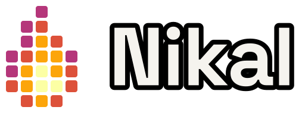
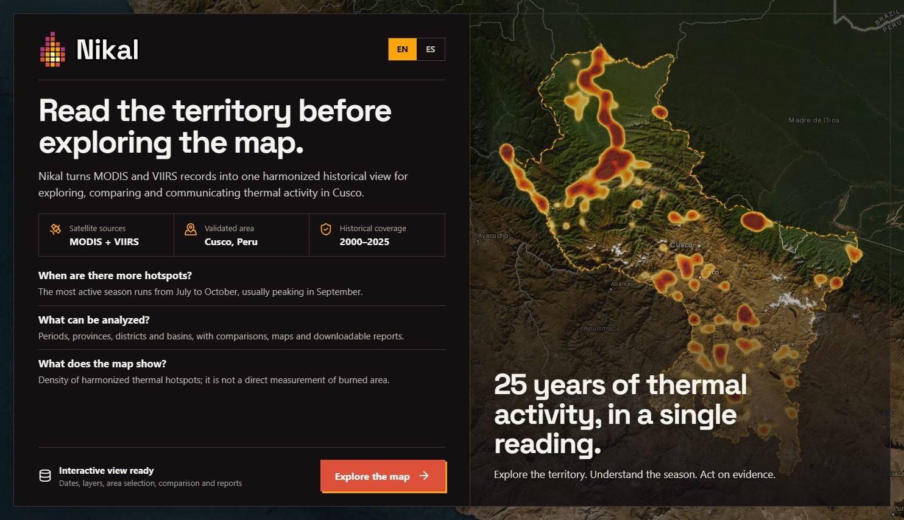
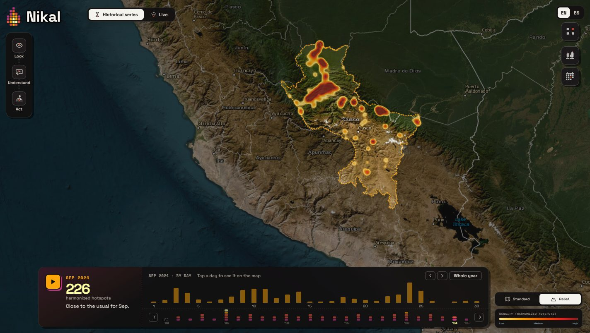
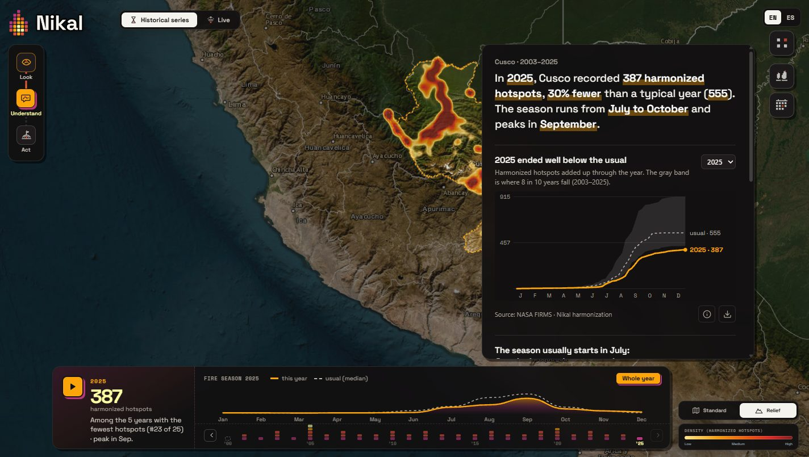
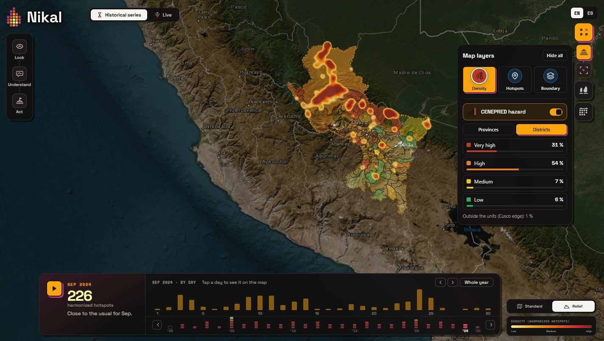
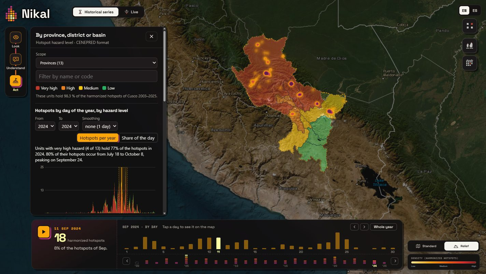
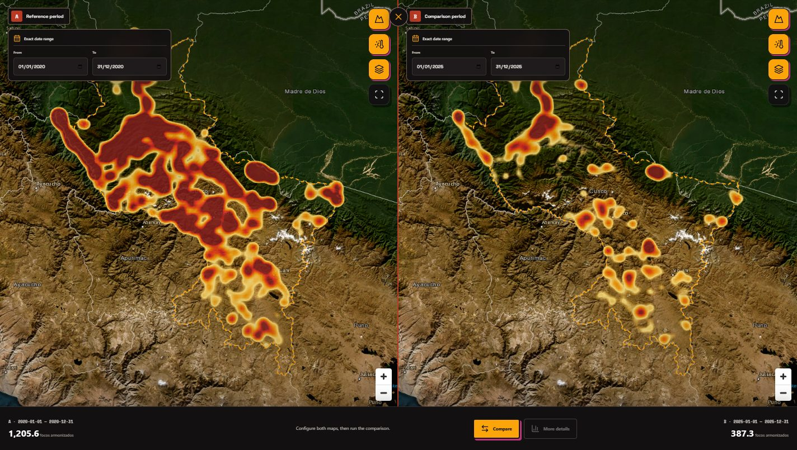
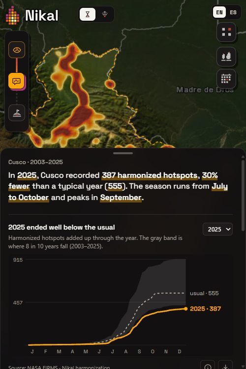

<p align="center">
  
</p>

<p align="center">
  <b>Harmonized MODIS + VIIRS fire hotspots for Cusco, Peru (2000–2025)</b><br>
  NASA Space Apps Challenge 2026 · Nubel Team
</p>

<p align="center">
  <a href="https://firecal-316891526626.southamerica-east1.run.app"><b>Live demo</b></a> ·
  <a href="#run-it-locally">Run it locally</a> ·
  <a href="#how-the-harmonization-works">Method</a> ·
  <a href="#data-sources-and-credits">Sources</a>
</p>

---

## What is Nikal?

NASA's FIRMS archive records active-fire detections from two generations of satellites: **MODIS** (1 km, since
2000) and **VIIRS** (375 m, since 2012). VIIRS sees three to four times more fire, so a long time series built by
simply stacking both sensors shows a jump in 2012 that has nothing to do with real fire activity.

**Nikal** builds a single, consistent **harmonized hotspot** series for the department of **Cusco, Peru**, from
November 2000 to December 2025, where *the source sensor no longer matters*. On top of that series it offers a web
map and plain-language analytics aimed at regional risk managers, forest analysts and fire brigades who need quick
answers:

- **Is this year normal?** The year's cumulative curve against the usual range.
- **When should we prepare?** The typical fire season, month by month.
- **Where is it concentrated?** By elevation band, by province/district/basin and by CENEPRED-style hazard level.

The analytics describe what the satellites already recorded; **they are not forecasts** and they do not measure
burned area.

## Screenshots

| | |
|---|---|
|  |  |
| **Welcome**: after the opening animation, the key facts next to the live relief map of Cusco. | **Map**: the bottom ribbon drives the map by year, month and day. |
|  |  |
| **Understand**: the headline finding first, then the evidence. | **CENEPRED hazard layer**: how the period's hotspots split by hazard level, with a per-level filter. |
|  |  |
| **Act**: hazard level per province/district/basin and hotspots by day of year. | **Compare**: two periods side by side. |

<p align="center"><br><i>Mobile layout (bottom sheet).</i></p>

## Features

- **Harmonized daily series (2000-11 → 2025-12)** on a 0.01° grid (~1.1 km), with a quality flag for every value
  (`referencia`, `calibrado`, `extrapolado`).
- **Season ribbon**: pick a year, a month or a single day; the map, the headline number and every panel follow.
- **Understand**: headline sentence with the key numbers, cumulative curve vs. the usual band, season by month with the
  "get ready" month marked, elevation bands and a 25-year ranking strip. Charts download as PNG or CSV.
- **Layers**: density, points and Cusco boundary can be stacked or hidden; the **CENEPRED hazard** layer colours each
  province or district by its hazard level and by its activity on the selected date, and filters the map by level.
- **Act (Ámbitos)**: relative hazard level per province, district and Pfafstetter basin (levels 1–12) using CENEPRED's
  four-level format and Saaty weights; per-unit reports for any period (view or PDF, with a map snapshot) and a CSV
  table.
- **Hotspots by day of year and hazard level**: computed on demand for any range of years and smoothing window.
- **Compare**: two date ranges on synchronized maps.
- **Technical report**: printable HTML for Cusco, a drawn box, a point or any unit, with method, limitations and
  checksums.
- **Live**: near-real-time FIRMS detections (last 24 h, 48 h or 5 days), shown apart from the harmonized series.
- **Welcome screen and guided tour** for first-time visitors.
- **English / Spanish** interface and API messages (English by default); keyboard-accessible; responsive down to
  390 px.
- **Hidden extra**: click the logo three times.

## How the harmonization works

The full technical methodology (data, model, validation, uncertainty, limitations and reproducibility) is in
[`METHODOLOGY.md`](METHODOLOGY.md), with a one-page summary in [`harmonizacion/docs/METODO.md`](harmonizacion/docs/METODO.md)
and the uncertainty analysis of `k` in [`harmonizacion/validacion/validacion_k.md`](harmonizacion/validacion/validacion_k.md).
The build and validation scripts are in [`harmonizacion/`](harmonizacion).

1. **Unit.** Presence of fire per grid cell (0.01°) and local day (UTC−5), not raw detections. Filters: vegetation
   fires (`type = 0`), MODIS confidence ≥ 30, VIIRS confidence nominal or high.
2. **VIIRS → MODIS scale.** Even per cell-day VIIRS sees ×3.0 to ×4.1 more fire than MODIS (sensitivity, not only
   resolution), so a factor `k` is calibrated per elevation stratum on 2013–2019: **0.330** (≥ 2,500 m) and
   **0.247** (< 2,500 m). Validation on 2020–2024: VIIRS×k / real MODIS = 0.90–1.09 per year.
3. **Early years.** Before Aqua (2002-07-04) only Terra exists; Terra-only days are scaled with `kT` (calibrated
   2003–2012) and flagged `extrapolado`.
4. **Series.** `Terra×kT` until 2002-07-03 → `MODIS` (weight 1.0) until 2012 → `VIIRS S-NPP×k` from 2013.
5. **Gap filling (v1.3).** The 45 days since 2013 without any S-NPP data over Peru are filled with **VIIRS NOAA-20**
   (`k20` = 0.324 / 0.235, calibrated 2018–2021, validated 2022–2025 at 0.98–1.05 per year).
6. **Per-hotspot weights.** Every detection carries `eq_foco`, so summing any region and period reproduces the
   cell-day series (total 2000–2025: **15,818 harmonized hotspots**).

Known limits: `kT` is imprecise (monthly error 41–45 %); 2025 shows a stronger MODIS drop than VIIRS (possible
orbital drift, not verified; the series uses VIIRS since 2013); the Cusco boundary is FAO GAUL simplified to
~500 m.

## Run it locally

The repository includes the harmonized data (`data/harmonized/`), so no external downloads are needed.

### Option A: Docker (recommended)

```bash
git clone https://github.com/Jyron1310/NASA_NUBEL_TEAM_NIKAL.git nikal
cd nikal/plataforma_local
docker compose up --build          # first build takes a few minutes
# open http://localhost:8000   (API docs at http://localhost:8000/docs)
```

### Option B: Python + Node (development)

Requirements: **Python ≥ 3.11** and **Node.js ≥ 18**.

```bash
# 1) Backend (FastAPI + DuckDB)
cd plataforma_local/backend
python -m venv .venv
source .venv/bin/activate          # Windows: .venv\Scripts\activate
pip install -r requirements-lock.txt
pip install -e . --no-deps
firecal plan-events                # validates the CSVs (checksums) and builds the Parquet store (~2 s)
firecal serve                      # API on http://localhost:8000

# 2) Frontend (React + Vite + MapLibre), in another terminal
cd plataforma_local/frontend
npm install
npm run build                      # the API then serves the app at http://localhost:8000
# or: npm run dev                  # hot reload at http://localhost:5173 (proxies /api to :8000)
```

Optional environment variables:

| Variable | Purpose |
|---|---|
| `FIRMS_MAP_KEY` | NASA FIRMS MAP_KEY for the **Live** layer ([request one](https://firms.modaps.eosdis.nasa.gov/api/map_key/)). Without it the rest of the app works. |
| `FIRECAL_SOURCE_ROOT` | Repository root, if the backend runs from another folder. |
| `FIRECAL_TRUST_PROXY`, `FIRECAL_PROXY_HOPS` | Behind a reverse proxy (Cloud Run: `1` and `1`), for per-client rate limits. |

Useful URL parameters: `?lang=es` (Spanish), `?intro=0` (skip the opening animation), `?welcome=0` (skip the welcome
screen), `?tutorial=1` (start the guided tour), `?diseno=dante` (previous interface).

### Tests

```bash
cd plataforma_local/backend && ruff check . && pytest -q      # 142 tests
cd plataforma_local/frontend && npm run lint
python -I harmonizacion/verificar_datos.py data/harmonized/harmonizado_cusco_celda_dia.csv \
    data/harmonized/focos_cusco_individuales.csv              # data integrity (rows, sums, SHA-256); needs pandas
```

## API at a glance

| Endpoint | What it returns |
|---|---|
| `GET /api/calendario` | Month × year harmonized calendar (values, anomaly, quality). |
| `GET /api/focos.geojson` · `GET /api/hotspots.csv` | Hotspots of a period/area (map) and the downloadable CSV. |
| `GET /api/resumen?graficos=true` | Plain-language findings and the data behind the Understand charts. |
| `GET /api/analitica/{estacionalidad,ranking,acumulado,altitud,recurrencia}` | Individual analytics. |
| `GET /api/ambitos/{nivel}` (`.geojson`, `.csv`) | CENEPRED-format hazard level per province, district or basin. |
| `GET /api/ambitos/{nivel}/dias` · `/dias/{dia}` | Hotspots by day of year and hazard level; cells of one day for the map. |
| `GET /api/informe` | Printable technical report. |
| `GET /api/tiempo-real?horas=24\|48\|120` | Near-real-time FIRMS detections (not harmonized). |

Areas can be the department (`departamento=PE-CUS`), a box (`bbox=W,S,E,N`) or a point (`lat`, `lon`, `radio_km`).
Full interactive documentation at `/docs`.

## Repository structure

```
plataforma_local/      web platform: backend (FastAPI, DuckDB) and frontend (React, Vite, MapLibre); Dockerfile
  backend/             API, analytics, CENEPRED-format hazard levels, reports, tests
  frontend/            interface (Nikal design), fonts, logo
data/harmonized/       harmonized cell-day series and individual hotspots (the product)
harmonizacion/         scripts that build and validate the harmonized series, data contracts, k uncertainty
media/                 30-second video of Nikal and the code that renders it
docs/                  screenshots and documentation index
METHODOLOGY.md         full technical methodology
```

## Data sources and credits

**Fire data**
- NASA FIRMS (Fire Information for Resource Management System). MODIS Collection 6.1 active fires (Terra and Aqua)
  and VIIRS 375 m active fires (Suomi NPP and NOAA-20), country archives up to 2025-12-31; near-real-time API for the
  Live layer. *We acknowledge the use of data and/or imagery from NASA's Fire Information for Resource Management
  System (FIRMS) (https://earthdata.nasa.gov/firms), part of NASA's Earth Science Data and Information System (ESDIS).*

**Geography**
- Cusco boundary: FAO GAUL (Global Administrative Unit Layers), accessed through Google Earth Engine.
- Elevation strata: SRTM digital elevation model (NASA/USGS), accessed through Google Earth Engine.
- Provinces and districts: INEI limits via [juaneladio/peru-geojson](https://github.com/juaneladio/peru-geojson)
  (reference limits, not official for legal purposes).
- River basins: HydroBASINS v1c, HydroSHEDS (Lehner & Grill, 2013), Pfafstetter levels 1–12.

**Methods and references**
- CENEPRED (Peru's National Center for Disaster Risk Estimation, Prevention and Reduction): four-level hazard format
  and the analytic hierarchy process (Saaty pairwise comparison) used for the relative hazard level. Nikal's level is
  an *input* for a CENEPRED assessment (it does not include vulnerability), not an assessment.
- Chart anatomy and storytelling patterns inspired by Our World in Data (owid-grapher) and Global Forest Watch
  (wri/gfw); pixel-icon style inspired by [pixelarticons](https://github.com/halfmage/pixelarticons) (MIT); all
  drawings are our own.

**Basemaps**
- Esri World Imagery and World Boundaries and Places (Source: Esri, Vantor, Earthstar Geographics, and the GIS User
  Community).
- OpenFreeMap (Positron style) with © OpenStreetMap contributors data.

**Software**
- Frontend: React, Vite, MapLibre GL JS, lucide-react, html2pdf.js.
- Backend: FastAPI, Uvicorn, DuckDB, pandas, NumPy, Shapely, httpx, Typer, Pydantic.
- Fonts: Space Grotesk and Space Mono (SIL Open Font License 1.1, included in `plataforma_local/frontend/public/fonts`).
- Hosting: Google Cloud Run.

## Team

**Nubel Team**: Julio, Antonio, Gabriel, Dante and Erik. Built for the NASA Space Apps Challenge 2026
(14–15 November 2026).

## License

No license has been chosen yet; until then all rights are reserved by the authors. Third-party data, fonts and
libraries keep their own licenses (see above).
